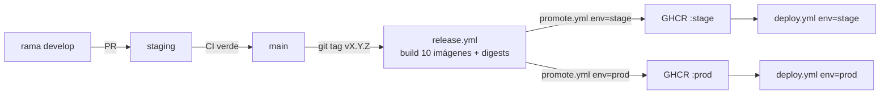

# 🤖 Automatización de Core Engine

Esta carpeta contiene los workflows de GitHub Actions que verifican, empaquetan y
despliegan Core Engine. El despliegue de los entornos sigue el contrato de
[`docs/rules/cd/`](../docs/rules/cd/) (`R-CD-1..13`) y el modelo de ramas de
[`docs/rules/git/00-entornos.md`](../docs/rules/git/00-entornos.md) (`R-GE-*`).

## Mapa

```text
.github/
├── workflows/
│   ├── ci.yml        # Integración continua (PR/push a main, develop, staging)
│   ├── release.yml   # Release por tag: construye y publica las 10 imágenes en GHCR
│   ├── promote.yml   # Promueve imágenes publicadas a stage/prod POR DIGEST, sin reconstruir
│   └── deploy.yml    # Despliegue manual por entorno + smoke del gateway
├── CODEOWNERS        # Revisión de caminos sensibles (R-CI-10)
└── dependabot.yml    # Actualización semanal de actions y dependencias npm
```

## Imágenes: una por servicio (R-CD-3, R-CD-4)

Cada servicio tiene su propio `packages/<servicio>/Dockerfile` (contexto de build =
raíz del workspace). El release publica, por servicio:

```text
ghcr.io/xozan845-ctrl/core-engine-<servicio>:v1.2.3   # tag de release
ghcr.io/xozan845-ctrl/core-engine-<servicio>:1.2.3    # semver (solo no-prerelease)
ghcr.io/xozan845-ctrl/core-engine-<servicio>:1.2
ghcr.io/xozan845-ctrl/core-engine-<servicio>:1
ghcr.io/xozan845-ctrl/core-engine-<servicio>:latest
ghcr.io/xozan845-ctrl/core-engine-<servicio>:sha-<corto>
```

## Flujo de entrega



1. **`ci.yml`** corre en cada PR y push a `main`, `develop`, `staging` (security-gate,
   lint, test+cobertura, build con gate OpenAPI `G-8`).
2. **`release.yml`** se dispara al empujar un tag `vX.Y.Z`. Su `gate` exige
   tag semver válido, que el commit esté en `main` y que haya un run de `ci.yml` en
   `success` **en ese SHA** (`R-CD-1`, `R-CD-2`). Luego construye y publica las 10
   imágenes con etiquetas OCI/semver y deja el digest en el resumen (`R-CD-4`).
3. **`promote.yml`** (manual) mueve una release publicada a `stage` o `prod`
   **por digest** (`@sha256:`), sin reconstruir (`R-CD-3`), con `dry_run` por defecto
   (`R-CD-8`) y `environment` como gate de producción (`R-CD-6`).
4. **`deploy.yml`** (manual) arranca el compose del entorno y ejecuta el smoke
   `GET /health` del gateway (`R-CD-12`): en `dev` construye; en `stage`/`prod`
   consume `docker-compose.stage.yml` (stage) / `docker-compose.yml` (prod) de GHCR.

## Recetas

```bash
# 1) Publicar una release (desde un commit de main con CI verde)
git tag v1.0.0 && git push origin v1.0.0

# 2) Promover a stage y desplegar (con simulacro opcional)
gh workflow run promote.yml -f environment=stage -f source=v1.0.0 -f dry_run=true
gh workflow run promote.yml -f environment=stage -f source=v1.0.0
gh workflow run deploy.yml  -f environment=stage

# 3) Promover a producción tras validar stage
gh workflow run promote.yml -f environment=prod -f source=v1.0.0
gh workflow run deploy.yml  -f environment=prod
```

## Entornos y variables

| Entorno | Compose | Imagen | Variables |
|---|---|---|---|
| dev | `docker-compose.dev.yml` | build local | `.env.example` → `.env` |
| stage | `docker-compose.stage.yml` | `:stage` (GHCR) | plantilla `.env.stage.example` (en Dockploy: pestaña *Environment* → `.env`) |
| prod | `docker-compose.yml` | `:prod` (GHCR) | plantilla `.env.production.example` (en Dockploy: pestaña *Environment* → `.env`) |

> Los composes de stage/producción leen el archivo que indique `ENV_FILE` y, por
> defecto, `.env` — el que escribe Dockploy desde la pestaña *Environment*. En
> local se les pasa el suyo: `ENV_FILE=.env.stage` / `ENV_FILE=.env.production`.
> `.env`, `.env.stage` y `.env.production` están en `.gitignore`: nunca se versionan
> (`R-CD-7`). Solo las plantillas `*.example`.
