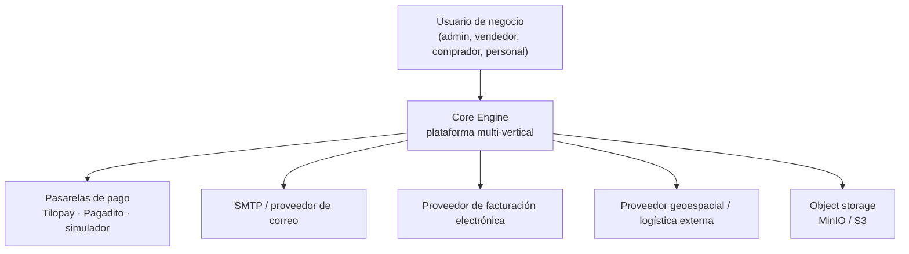

# 01 — Principios, estilo y modelo arquitectónico

## 1. Estilo elegido

Core Engine es una **arquitectura de microservicios por capacidad de negocio**
sobre un **modelo de tenancy multi-vertical**. Cada servicio es un *bounded
context* de DDD con:

- su propio modelo de dominio y lenguaje ubicuo (en español);
- su propio esquema PostgreSQL (Database per Service);
- su propio ciclo de build, imagen y despliegue;
- contratos explícitos hacia fuera (HTTP/OpenAPI y eventos).

No es un monolito modular distribuido por capas técnicas. Tampoco es un
microservicio por entidad ni por pantalla. La unidad de descomposición es la
**capacidad** (`catalogo_items`, `inventario_stock`, `orders`, `facturacion`,
`agenda_recursos`, `logistica_rutas`, `operacion_campo`, `analitica_negocios`…),
y las verticales (retail, farmacia, belleza, flota) se activan por configuración
(ADR-0001).

### Qué se comparte y qué no

| Se comparte | No se comparte |
|---|---|
| Contrato HTTP (envelope, errores, versionado) | Modelo de dominio entre servicios |
| Topic de eventos y envelope (`tipo`, `event_id`, `data`) | Tablas o esquemas PostgreSQL |
| Convenciones de observabilidad y seguridad | Runtime compartido de negocio |
| Catálogo de servicios, reglas y fitness functions | Estado en memoria o filesystem local |
| Infraestructura (Postgres, RabbitMQ, MinIO) | Credenciales o claves entre servicios |

La duplicación deliberada de `config.rs`, `db.rs`, `errors.rs`, `state.rs`,
`logs.rs`, `metrics.rs`, `outbox.rs` y `rabbit.rs` es el **precio explícito de la
autonomía** (R-AR-5/R-MS-1). Un paquete compartido de runtime exigiría ADR y
demostrar que no acopla los ciclos de despliegue.

## 2. Niveles C4

### C1 — Contexto



Las integraciones externas viven detrás de una **capa anticorrupción** (ACL):
`orders/pasarelas`, `finance` (fiscal), `notifications` (email/SMS/WhatsApp),
`storage` (S3/MinIO). Ningún modelo externo entra al dominio (R-AR-6).

### C2 — Contenedores

- **api-gateway**: perímetro; JWT HS256, políticas por ruta/rol, CORS, rate
  limit, proxy streaming, readiness agregada. Único puerto público.
- **16 servicios Rust**: cada uno con su esquema, su imagen y su manifiesto.
- **PostgreSQL 16**: un esquema por servicio; RLS para multi-tenancy.
- **RabbitMQ**: topic `core-engine.events`, colas por consumidor, DLQ y reintentos.
- **MinIO/S3**: un bucket por tenant; URLs prefirmadas.
- **Prometheus + Grafana + Alertmanager**: métricas, dashboards como código,
  alertas con runbook.
- **Dockploy/Traefik**: TLS y despliegue por entornos (`dev`, `staging`,
  `produccion`).

La vista de contenedores generada y el detalle de puertos/esquemas están en
[`catalogo-servicios.md`](./catalogo-servicios.md).

### C3 — Componentes de un servicio

Todos los servicios siguen el mismo esqueleto (R-MS-1/R-MS-2/R-MS-10):

```text
packages/<servicio>/
├── service.json          # contrato declarativo (R-MS-9)
├── Cargo.toml            # crate autónomo, publish = false
├── Cargo.lock
├── Dockerfile            # multi-stage, runtime no-root
├── README.md             # bounded context, capacidades, tablas, env
├── src/
│   ├── main.rs           # bootstrap: config, pool, router, señales
│   ├── lib.rs            # superficie de biblioteca + módulos
│   ├── config.rs         # entorno fail-fast (única lectura de env)
│   ├── db.rs             # pool, RLS, helpers de filas
│   ├── errors.rs         # ApiError + IntoResponse
│   ├── state.rs          # AppState (DI por Arc)
│   ├── logs.rs           # logs JSON + correlación
│   ├── metrics.rs        # métricas RED + negocio
│   ├── auth.rs           # identidad/capacidades desde headers
│   ├── http/             # router, handlers, envelope {data,meta}
│   ├── <dominio>/        # agregados, casos de uso, SQL explícito
│   ├── outbox.rs         # si publica eventos (R-AR-3)
│   ├── rabbit.rs         # si usa broker
│   └── lifecycle.rs      # purga/exportación/retención si aplica
└── tests/                # integración HTTP/BD
```

**Dirección de dependencias:** `http/` conoce el dominio y los DTO; el dominio
no conoce `axum` salvo para extraer cabeceras cuando es inevitable (hoy ocurre en
`auth.rs`/`errors.rs`). `main.rs` es composición, no lógica. El SQL vive en el
dominio o en adaptadores, no en los handlers salvo rutas internas de
mantenimiento.

### C4 — Código

Reglas de nomenclatura y modularidad: R-NC-1..8 y R-MS-7. Un archivo de dominio
no supera 800 líneas de producción ni 20 funciones públicas con SQL; se divide
por responsabilidad, no por tipo técnico.

## 3. Comunicación

### 3.1 Matriz de decisión

| Necesidad | Mecanismo | Regla |
|---|---|---|
| Cliente → plataforma | HTTPS al gateway | R-GW-1 |
| Consulta de lectura idempotente entre servicios | HTTP interno con timeout, sin mutar estado | R-AR-2 (excepción) |
| Mutación crítica entre servicios | Evento de dominio por outbox + RabbitMQ | R-AR-2/R-AR-3 |
| Consulta de datos de otro servicio | API interna o proyección local por eventos | R-DB-1/R-MS-16 |
| Proceso de negocio largo | Saga por coreografía con compensaciones | ADR-02 |
| Integración externa | ACL + adaptador | R-AR-6 |
| Tarea programada | Worker del servicio (no cron externo) | R-MS-1 |

**Regla dura:** ninguna mutación crítica depende de una llamada HTTP síncrona a
otro servicio. Si se usa HTTP para lectura, el llamador declara timeout y
degradación (circuit breaker o respuesta parcial) y la dependencia queda en el
manifiesto (`dependencies.sync`).

### 3.2 Contrato HTTP

- Superficie pública versionada: `/api/v2/...` (R-GW-7).
- Superficie interna: `/internal/...`, protegida por `x-internal-key` y nunca
  enrutada desde el borde (R-DS-5).
- Éxito: envelope `{ "data": ..., "meta": { timestamp, path, method, statusCode } }`.
- Error: `{ "codigo": "UPPER_SNAKE_CASE", "mensaje": "...", "detalles"?: ... }`,
  sin stacktrace (R-GW-6).
- Montos en centavos enteros; serialización explícita (R-DI-1, ADR-01).
- Fechas ISO 8601 UTC con `Z`.
- `Idempotency-Key` obligatorio en mutaciones críticas (R-DI-4, ADR-0033).

OpenAPI es la fuente del contrato público; `swagger:export` se versiona y CI
falla si hay diff (R-DO-6/R-C-7).

### 3.3 Contrato de eventos

Envelope mínimo (compatible con la práctica de CloudEvents, sin afirmar
conformidad total todavía):

```json
{
  "tipo": "order.created",
  "event_id": "uuid",
  "data": { "...": "..." },
  "request_id": "uuid",
  "ocurrido_en": "2026-11-24T12:00:00Z"
}
```

- **Un dueño por evento**; el productor lo declara en `service.json`.
- **Outbox transaccional**: el evento se inserta en `<schema>.outbox` en la misma
  transacción que el cambio de negocio (R-AR-3).
- **Relay**: worker del servicio publica al topic con confirmación y métricas de
  pendientes/fallos.
- **Consumidor idempotente**: `<schema>.eventos_procesados` por `event_id`, en la
  misma transacción del efecto (R-DI-4).
- **Reintentos + DLQ**: backoff; tras `REINTENTOS_MAXIMOS` va a `.dlq` sin
  bloquear la cola principal (R-AR-4).
- **Trazabilidad**: `x-request-id` viaja en el registro del outbox y en las
  cabeceras del mensaje (R-OB-2).
- **Evolución**: cambios aditivos; renombrar/retirar exige migración de
  consumidores y ADR (R-MS-14).

La matriz generada está en [`matriz-eventos.md`](./matriz-eventos.md).

## 4. Datos y tenancy

- **Database per Service**: un esquema por servicio; sin `JOIN` cross-schema
  (R-DB-1/R-MS-16). Las excepciones actuales están congeladas como deuda.
- **Migraciones**: `infra/db/init/*.sql` es la fuente canónica, con manifiesto de
  hashes; ningún cambio manual en producción (R-DB-6).
- **RLS**: toda tabla transaccional tiene RLS y políticas versionadas; el
  contexto se inyecta con `set_config` (R-DB-2/R-SB-2/R-SB-3).
- **Soft delete**: datos transaccionales no se borran físicamente (R-DB-5).
- **Montos**: enteros en centavos; prohibido `float` para dinero (R-DI-1).
- **Inventario**: operaciones relativas y atómicas con `SELECT ... FOR UPDATE` +
  `CHECK (stock >= 0)` (R-DI-2).
- **Estados**: máquinas de estado explícitas para pedidos, envíos y
  liquidaciones (R-DI-3).
- **Partida doble**: todo asiento contable balancea a cero (R-DI-5).
- **Tenancy**: `empresa_id`/`negocio_id` en toda escritura; las capacidades se
  validan antes de operar (`CapabilityGuard`).

## 5. Resiliencia

| Mecanismo | Implementación | Regla |
|---|---|---|
| Timeout | Todo cliente HTTP interno declara timeout | R-RB-4 |
| Reintento | Backoff exponencial en consumidores | R-AR-4 |
| DLQ | Cola muerta + reinyección controlada | R-AR-4 |
| Idempotencia | `event_id` / `Idempotency-Key` | R-DI-4 |
| Autonomía | Caché/proyección local; el servicio sigue operando si otro cae | R-AR-5 |
| Apagado | `SIGINT`/`SIGTERM` + `with_graceful_shutdown` | R-MS-6 |
| Readiness | `/ready` con 503 si falta dependencia | R-MS-11 |
| Saga | Compensaciones (`stock.fallido`, reembolsos, notas de crédito) | ADR-02/0039 |

## 6. Seguridad

- **Borde**: TLS terminado fuera; gateway valida JWT HS256, limpia cabeceras
  internas y aplica políticas por ruta/rol (R-GW-1..3, ADR-0005).
- **Identidad**: `identity` es la autoridad de tenants, roles, capacidades y API
  keys; los servicios confían en `x-user-*` sólo desde la red interna.
- **Rutas internas**: `x-internal-key` obligatorio (R-DS-5).
- **Datos**: RLS, mínimo privilegio, PII fuera de logs, secretos sólo por entorno
  (R-DS-1/R-DS-2/R-OB-5).
- **API keys**: intercambio por JWT corto; nunca al navegador (R-GW-8).
- **Dependencias**: `cargo audit`, `cargo deny` (cuando aplique), `npm audit` y
  escaneo de secretos en CI (R-DS-7/R-QA-6).

## 7. Observabilidad y SLO

- `/health` = liveness; `/ready` = readiness; `/metrics` = Prometheus.
- Métricas RED obligatorias y etiquetas de baja cardinalidad (R-TM-2..4).
- Logs JSON con nivel, servicio, `request_id` y sin PII (R-OB-1/R-OB-4/R-OB-5).
- `x-request-id` se propaga por HTTP y por outbox/RabbitMQ (R-OB-2).
- SLO de plataforma en [`docs/slo.md`](../slo.md): disponibilidad 99,5 %, p95
  < 1,5 s, outbox < 100, DLQ sin crecimiento neto.
- Dashboards y alertas como código en `infra/grafana` y `infra/prometheus`.

## 8. Entrega y operación

- **12-factor**: una imagen inmutable por servicio, configuración por entorno,
  procesos stateless, logs a stdout, puertos explícitos, apagado ordenado.
- **Tres entornos**: `dev` → `staging` → `producción`; promoción por PR, no
  rebuild (R-GE-1/R-CD-9..13).
- **Imágenes**: GHCR con digest; runtime `debian` slim, usuario no-root, sin
  toolchain (R-CD-14).
- **Compose**: un servicio por archivo de compose; `PORT` y `OUTBOX_TABLA`
  alineados con el manifiesto.
- **CI**: fmt, clippy `-D warnings`, tests, cobertura por umbral, audit, build de
  imagen, reglas, contrato OpenAPI y catálogo de arquitectura.
- **Rollback**: imágenes inmutables + migraciones expand/contract; runbook de
  entrega.

## 9. Decisiones que no se reabren sin ADR

1. Servicios por capacidad, no por vertical (ADR-0001).
2. Database per Service y RLS (ADR-0001/0018).
3. Outbox transaccional para eventos (ADR-03/0002).
4. CQRS/Event Sourcing sólo en `orders` (ADR-0013).
5. Gateway como único punto de entrada y JWT en el borde (ADR-0005/0015).
6. Excepción OLAP para `analytics`/`market-intelligence` (ADR-0009/0022).
7. Manifiesto de servicio y fitness functions como contrato ejecutable
   (ADR-0050).

Cambiar cualquiera de estas decisiones exige ADR nuevo, enmienda de la regla y
actualización de su fitness function en el mismo PR (R-AF-5).
