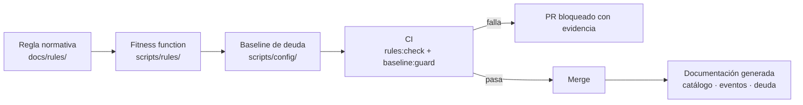

# 03 — Conformidad, fitness functions y operación

## 1. Modelo de gobernanza

La arquitectura se protege en tres capas:



- **Norma:** qué debe cumplirse (ID + redacción verificable).
- **Fitness function:** evidencia automática; falla el build con servicio y
  remediación.
- **Baseline:** deuda existente congelada; sólo puede reducirse.
- **Documentación generada:** vista humana del mismo dato; CI detecta drift.

Si una propiedad no se puede automatizar, se marca como tal y se revisa en el
checklist de PR. No se deja como “regla de wiki” (R-AF-1).

## 2. Catálogo de fitness functions

| Propiedad | Regla | Evidencia automática | Disparador |
|---|---|---|---|
| Inventario y artefactos | R-MS-1, R-CD-3/4/14 | `services-monorepo`, `microservices-ci-contract` | PR |
| Manifiesto y perfil | R-MS-9/R-MS-10 | `services-contract` | PR |
| Propiedad de datos | R-DB-1/R-MS-16 | `services-contract` (SQL cross-schema) | PR |
| Outbox y eventos | R-AR-3/R-MS-14 | `services-contract` + matriz de eventos | PR |
| Arranque y shutdown | R-MS-5/R-MS-6 | `services-contract` | PR |
| Salud y readiness | R-MS-11 | `services-contract` + baseline | PR |
| Observabilidad | R-TM-1/4, R-OB-1/2 | `observability-telemetry`, `observability-tracing`, `services-contract` | PR |
| Contrato HTTP | R-DO-6/R-C-7 | `contract-openapi`, `swagger:export` diff | PR |
| Migraciones | R-DB-6 | `database-migrations` | PR |
| RLS | R-SB-2 | `database-rls` | PR |
| Secretos | R-DS-1 | `security-secrets-hygiene`, `security:secrets` | PR |
| SQL injection/SSRF/uploads | R-DS-4/5 | suites `security-*` | PR |
| Tamaño de módulos | R-MS-7 | `microservices-tamano-modulos` | PR |
| Entrega | R-CD-1/3/7/8 | `delivery-compose` | PR |
| Catálogo/documentación | R-AF-4 | `architecture:check` | PR |
| Deuda | R-AF-2 | `baseline:guard` | PR |
| SLO en runtime | docs/slo.md | Prometheus/Alertmanager | Continuo |

## 3. La suite `services-contract`

Es la fitness function del contrato de servicio. Contraste:

1. **Manifiesto:** esquema JSON, campos obligatorios, nombre y bounded context.
2. **Identidad:** carpeta = crate = binario = imagen = manifiesto.
3. **Artefactos:** `Cargo.toml`, `Cargo.lock`, `Dockerfile`, `README.md`,
   `src/main.rs`, `src/lib.rs`.
4. **Compose:** presencia por entorno, `PORT`, `OUTBOX_TABLA`.
5. **Esquema:** `spec.schema` existe como `CREATE SCHEMA` en `infra/db/init`.
6. **Módulos:** mínimos del perfil, declarados en `lib.rs`.
7. **Arranque:** `Config::from_env`, fail-fast, `0.0.0.0`, graceful shutdown.
8. **Observabilidad:** `/health`, `/metrics`, RED, logs JSON.
9. **Eventos:** nombres reales en `src/`, publisher único, sin huérfanos.
10. **Dependencias:** servicios declarados existen en el catálogo.
11. **Documentación:** README y OpenAPI.
12. **Deuda:** nuevas violaciones fallan; entradas obsoletas también.

## 4. Deuda actual

| Tipo | Entradas | Significado | Remedación |
|---|---:|---|---|
| `readiness` | 15 | Servicios con BD sin `/ready` | Añadir `/ready` con `SELECT 1` + ping a RabbitMQ; 503 si falla |
| `env` | 6 | Lecturas de entorno fuera de `config.rs` | Mover a `Config`, inyectar por `AppState` |
| `cross-schema` | 13 | SQL contra esquemas ajenos | API interna, evento + proyección o vista materializada propia |

Detalle por servicio en [`deuda-arquitectura.md`](./deuda-arquitectura.md).

**Política:** una entrada nueva exige ADR y justificación; `baseline:guard`
falla si se añade. Una entrada corregida se retira en el mismo PR; la suite falla
si queda obsoleta. El objetivo es llegar a cero, no normalizar la deuda.

### Prioridad sugerida

1. **Cross-schema de escritura** (inventory → item, identity → inventory):
   mayor riesgo de acoplamiento y corrupción. Mover a API interna/evento.
2. **`/ready` en servicios críticos** (orders, inventory, identity, finance):
   evita enviar tráfico a un servicio sin BD.
3. **Env fuera de config**: bajo riesgo, alta higiene; hacerlo al tocar cada
   módulo.
4. **Cross-schema de lectura analítica** (analytics/commissions): reemplazar por
   proyecciones locales alimentadas por eventos.

## 5. Cómo ejecutar

```bash
npm run rules:check                 # 24 suites, incluida services-contract
npm run architecture:check          # catálogo/matriz/deuda sin drift
npm run architecture:report         # regenera los 3 documentos
npm run architecture:baseline       # muestra el delta de deuda
npm run baseline:guard              # la deuda no crece
npm run test:engine                 # el motor se prueba a sí mismo
npm run test:smoke                  # runners y contrato OpenAPI
```

En CI:

- `rules-check`: reglas + arquitectura + baseline.
- `rust`: fmt, clippy, tests y cobertura por matriz derivada.
- `docker-build`: una imagen por servicio.
- `build`: OpenAPI sincronizado + arquitectura sincronizada.

## 6. Cómo añadir una regla o fitness function

1. **Escribe la regla** en `docs/rules/<área>/NN-tema.md` con ID nuevo, redacción
   imperativa y evidencia.
2. **Decide si es automatizable.**
   - Sí: crea/edita una suite en `scripts/rules/<dominio>/`.
   - No: documenta por qué y añádela al checklist.
3. **Declara la suite** con `defineSuite({ id, area, rules, mode, run })`.
4. **Regístrala** en `scripts/config/manifest.mjs`.
5. **Si encuentra deuda preexistente**, añádela a
   `scripts/config/architecture-baseline.json` con justificación; si es una regla
   dura, corrige el repositorio en el mismo PR.
6. **Actualiza** el mapa de IDs del área y, si aplica, el catálogo de fitness
   functions.
7. **Verifica** `npm run rules:check`, `npm run baseline:guard` y
   `npm run test:engine`.

## 7. Cómo se audita

- **Cada PR:** gates automáticos; el autor adjunta evidencia de lo que no es
  automatizable.
- **Cada release:** revisión de deuda, SLO y cobertura; se actualiza
  `docs/rules/_meta/AUDIT.md` y su histórico.
- **Trimestral:** revisión de SLO, capacidad y reglas obsoletas. Una regla que ya
  no protege nada se retira con ADR, no se ignora.
- **Post-incidente:** si faltó una fitness function que lo habría detectado, se
  añade en el PR de remediación (R-REG-3).

## 8. Señales de que la gobernanza funciona

- Un servicio nuevo no requiere editar listas en CI, compose o `project.mjs`.
- Un PR que añade deuda arquitectónica se pone rojo con un mensaje accionable.
- La documentación de arquitectura no se edita a mano: se regenera.
- El catálogo y la matriz de eventos coinciden con el código.
- La deuda baja de forma monotónica; nunca sube.
