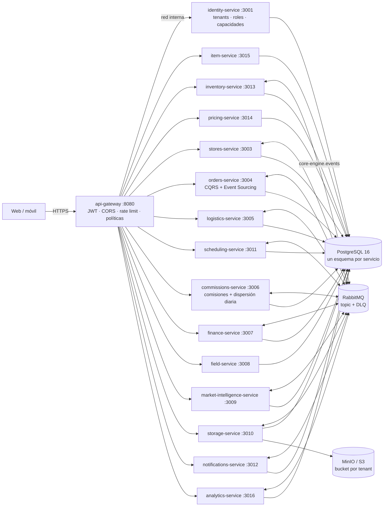

# Arquitectura de Core Engine

Este directorio es la **vista arquitectónica** del sistema: principios, estilo,
contexto, contratos y guía de evolución. No sustituye a las reglas normativas:
cada afirmación relevante apunta a un ID de [`docs/rules/`](../rules/README.md),
y cada regla verificable tiene una *fitness function* en `scripts/rules/`.

| Documento | Qué responde |
|---|---|
| [`01-principios-y-estilo.md`](./01-principios-y-estilo.md) | ¿Qué estilo arquitectónico tenemos y por qué? Contexto, dominios, comunicación, datos, resiliencia, seguridad y operación. |
| [`02-contrato-de-servicio.md`](./02-contrato-de-servicio.md) | ¿Qué debe cumplir un microservicio para considerarse parte de la plataforma? |
| [`03-conformidad-y-operacion.md`](./03-conformidad-y-operacion.md) | ¿Cómo se verifica, qué deuda existe y cómo se añade una fitness function? |
| [`04-guia-nuevo-servicio.md`](./04-guia-nuevo-servicio.md) | ¿Cómo se crea un servicio nuevo sin romper la arquitectura? |
| [`catalogo-servicios.md`](./catalogo-servicios.md) | Vista generada de los 16 servicios: contexto, perfil, puerto, esquema, capacidades, eventos y owner. |
| [`matriz-eventos.md`](./matriz-eventos.md) | Vista generada de eventos: quién publica y quién consume. |
| [`deuda-arquitectura.md`](./deuda-arquitectura.md) | Deuda congelada: readiness, configuración y acoplamiento de esquemas. |

Los tres últimos son **derivados**: se generan desde
`packages/<servicio>/service.json` con `npm run architecture:report` y CI falla
si hay diff (`npm run architecture:check`, R-AF-4).

---

## La arquitectura en una página

Core Engine es una **plataforma multi-vertical por capacidades**. No hay un
servicio por rubro (`dentista-service`, `farmacia-service`); hay servicios por
**capacidad de negocio** y un modelo de tenancy que activa capacidades por
empresa/negocio (ADR-0001).

**Reglas de oro de la topología**

1. **Un único punto de entrada**: sólo `api-gateway` publica puerto al host. Los
   microservicios viven en la red interna `core-engine` (R-GW-1/R-GW-2).
2. **Un esquema por servicio**: cada servicio es dueño exclusivo de su esquema
   PostgreSQL; nunca consulta el de otro (R-DB-1/R-MS-16).
3. **Mutaciones críticas por eventos**: la saga de checkout no depende de HTTP
   síncrono entre servicios; los eventos salen por outbox transaccional
   (R-AR-2/R-AR-3).
4. **CQRS/Event Sourcing sólo donde el dominio lo justifica**: `orders-service`.
   El resto usa CRUD convencional (R-AR-1).
5. **OLAP separado**: `analytics` y `market-intelligence` tienen perfiles de
   lectura/proyección, no mutan el dominio transaccional (R-MI-1).
6. **Toda decisión es verificable**: manifiesto de servicio + fitness functions
   + baseline de deuda (R-MS-9..16, R-AF-1..5).

## Principios rectores

| Principio | Consecuencia práctica | Regla |
|---|---|---|
| **Bounded contexts, no capas técnicas** | Cada servicio posee su modelo, su esquema y su ciclo de despliegue. | R-MS-1, R-DB-1 |
| **Autonomía antes que DRY** | Se acepta duplicar `config/db/errors/outbox/rabbit`; no se crea un runtime compartido sin ADR. | R-AR-5, R-MS-1 |
| **Contratos explícitos** | OpenAPI para HTTP, manifiesto y matriz para eventos, `service.json` para el servicio. | R-DO-6, R-MS-9, R-MS-14 |
| **Consistencia eventual con outbox** | La transacción de negocio y el evento son atómicos; el relay publica después. | R-AR-3 |
| **Idempotencia por defecto** | Consumidores por `event_id`, mutaciones críticas por `Idempotency-Key`. | R-DI-4 |
| **Fail-fast y disposabilidad** | Configuración validada al arrancar, `0.0.0.0`, apagado ordenado ante SIGTERM. | R-MS-5, R-MS-6 |
| **Observabilidad como contrato** | `/health`, `/ready`, `/metrics`, logs JSON y `x-request-id` en HTTP y eventos. | R-MS-11, R-MS-15 |
| **Seguridad en profundidad** | JWT en el borde, `x-internal-key` en rutas internas, RLS en la BD, secretos fuera del repo. | R-GW-3, R-DS-1, R-DS-5, R-SB-2 |
| **Evolución guiada** | Cada propiedad arquitectónica tiene una fitness function; la deuda se congela y sólo baja. | R-AF-1, R-AF-2 |
| **Documentación derivada** | Catálogo, matriz de eventos y deuda se generan; no se editan a mano. | R-AF-4 |

## Referencias de industria

La declaración se apoya en estándares y prácticas verificables, no en moda:

- **12-Factor App** — configuración por entorno, procesos stateless, logs como
  stream, disposabilidad: <https://12factor.net/>
- **Microservices pattern language** (Chris Richardson) — Database per Service,
  Saga, Transactional Outbox, CQRS, Service Template, Microservice Chassis:
  <https://microservices.io/patterns/>
- **Service Template vs. Chassis** — por qué un template se copia y deriva, y un
  chassis acopla el runtime: <https://microservices.io/patterns/service-template.html>
- **Martin Fowler — Microservice Premium / Monolith First** — no adoptar
  microservicios sin justificación de complejidad:
  <https://martinfowler.com/bliki/MicroservicePremium.html>,
  <https://martinfowler.com/bliki/MonolithFirst.html>
- **Sam Newman — Building Microservices** — límites, desacoplamiento y
  operación: <https://samnewman.io/books/building_microservices_2nd_edition/>
- **Team Topologies** — ownership por equipo y cognitive load:
  <https://teamtopologies.com/>
- **Azure Architecture Center — Microservices** — modelado por dominio,
  aislamiento de datos, estándares de logging/monitoring:
  <https://learn.microsoft.com/azure/architecture/guide/architecture-styles/microservices>
- **Building Evolutionary Architectures / fitness functions** — Thoughtworks:
  <https://www.thoughtworks.com/insights/articles/fitness-function-driven-development>
- **Backstage Software Catalog** — ownership, lifecycle, system/domain,
  `catalog-info.yaml`: <https://backstage.io/docs/features/software-catalog/descriptor-format>
- **CloudEvents** — envelope interoperable de eventos:
  <https://cloudevents.io/>
- **AsyncAPI** — contrato de APIs event-driven:
  <https://www.asyncapi.com/docs/reference/specification/latest>
- **OpenAPI + Spectral/oasdiff** — contrato HTTP y detección de breaking changes:
  <https://spec.openapis.org/oas/latest.html>
- **Google API Design Guide** — diseño de APIs consistente:
  <https://cloud.google.com/apis/design>
- **Google SRE** — SLI/SLO, error budget, golden signals:
  <https://sre.google/sre-book/service-level-objectives/>
- **C4 model** — contexto, contenedores, componentes y código:
  <https://c4model.com/>
- **ADR (Nygard)** — registro de decisiones:
  <https://adr.github.io/>
- **OWASP ASVS** — verificación de seguridad de aplicaciones:
  <https://owasp.org/www-project-application-security-verification-standard/>
- **SLSA / OpenSSF** — integridad de la cadena de suministro:
  <https://slsa.dev/>

## Estado actual

- **16 servicios** desplegables, todos crates Rust, con manifiesto `service.json`.
- **67 de 254 IDs de regla** con check ejecutable; 24 suites en `rules:check`.
- **34 entradas de deuda** congeladas y visibles en
  [`deuda-arquitectura.md`](./deuda-arquitectura.md): 15 servicios sin `/ready`,
  6 archivos que leen entorno fuera de `config.rs`, 13 acoplamientos de esquema.
- La deuda **no puede crecer**: `baseline:guard` + suite `services-contract`.

> El detalle de cumplimiento por capa (testing, cobertura, gates) vive en
> [`docs/rules/_meta/AUDIT.md`](../rules/_meta/AUDIT.md). Este directorio declara
> la arquitectura; el AUDIT mide su estado.
