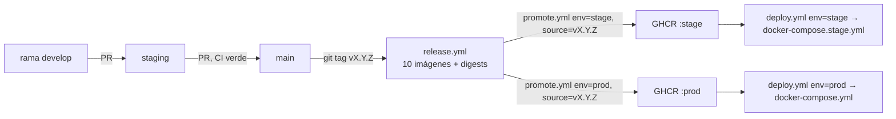

# Runbook — Entrega: `release` → `promote` → `deploy`

Guía operativa para llevar un cambio desde `main` hasta un entorno. Une lo que
está repartido entre [`.github/README.md`](../.github/README.md),
[`docs/rules/cd/01-despliegue.md`](./rules/cd/01-despliegue.md) (`R-CD-1..8`) y
[`docs/rules/cd/02-entornos.md`](./rules/cd/02-entornos.md) (`R-CD-9..13`).

> **Idea clave.** Tres acciones distintas que se confunden a menudo:
> 1. **Release** — se construye **una imagen por servicio** una sola vez y se publica versionada (tag de Git).
> 2. **Promote** — se **copian por digest** las etiquetas a un entorno (`stage`/`prod`), sin reconstruir.
> 3. **Deploy** — se **arranca** el compose del entorno con esas imágenes y se valida el smoke.
>
> El **tag de Git** decide **qué versión**; el input **`environment`** decide **a qué entorno**.

---

## 1. Modelo mental



Cada servicio se publica y se promueve con su propia imagen:

```text
ghcr.io/xozan845-ctrl/core-engine-<servicio>:<tag|stage|prod>
```

Servicios: `api-gateway`, `identity-service`, `catalog-service`, `stores-service`,
`orders-service`, `logistics-service`, `commissions-service`, `finance-service`,
`field-service`, `market-intelligence-service`, `storage-service`.

---

## 2. Requisitos previos

- **`gh` autenticado** para lanzar los workflows manuales (o usar la pestaña *Actions*).
- **Login en GHCR** en el host que tire de las imágenes (repo privado → paquetes privados):

  ```bash
  echo "$GHCR_TOKEN" | docker login ghcr.io -u xozan845-ctrl --password-stdin
  # GHCR_TOKEN = PAT con permiso read:packages
  ```

- **Procedencia** (`R-CD-2`): el commit del tag debe estar en `main` y tener un run de
  `ci.yml` en `success` **en ese mismo SHA**.

---

## 3. Paso 1 — Release (construir una vez)

```bash
# El tag se crea sobre un commit ya presente en main.
git switch main && git pull --rebase
git tag v1.0.0
git push origin v1.0.0
```

**Simulacro** (construye y no publica, `R-CD-8` — por defecto):

```bash
gh workflow run release.yml -f source_tag=v1.0.0            # dry_run=true por defecto
gh workflow run release.yml -f source_tag=v1.0.0 -f dry_run=false   # publica
```

`release.yml`: `gate` valida tag semver + procedencia; luego **una imagen por servicio**
con etiquetas `vX.Y.Z`, `X.Y.Z`, `X.Y`, `X`, `latest` (solo no-prerelease), `sha-<corto>`,
labels OCI y **digest** en el resumen del run (`R-CD-4`).

---

## 4. Paso 2 — Promote (mover sin reconstruir, por digest)

```bash
# A stage (con gate del Environment "stage" si está configurado)
gh workflow run promote.yml -f environment=stage -f source=v1.0.0 -f dry_run=true
gh workflow run promote.yml -f environment=stage -f source=v1.0.0

# A prod, solo tras validar stage
gh workflow run promote.yml -f environment=prod -f source=v1.0.0
```

`promote.yml` resuelve el digest del índice publicado por `release.yml`
(`docker buildx imagetools inspect`) y lo **copia** con `buildx imagetools create`
a `:stage`/`:prod`, verificando que el digest destino es **idéntico** al de
origen (si no, el run falla). Promover **no** reconstruye ni reempaqueta el
artefacto, y **no** despliega.

---

## 5. Paso 3 — Deploy (validar el arranque)

```bash
gh workflow run deploy.yml -f environment=stage   # dev | stage | prod
```

`deploy.yml` arranca el compose del entorno y espera el smoke `GET /health` del gateway,
que comprueba readiness de **todos** los servicios (`R-CD-12`).

**En el host** (equivalente manual):

```bash
docker compose -f docker-compose.stage.yml up -d
curl -fsS http://localhost:8080/health
(cd . && npm run demo)   # flujo real contra el entorno

# Fijar una versión exacta por digest (trazabilidad)
API_IMAGE_OVERRIDE=... docker compose -f docker-compose.yml up -d   # ver nota
```

> `docker-compose.yml` y `docker-compose.stage.yml` referencian `:prod`/`:stage`.
> Para fijar un digest concreto, edita la etiqueta del servicio o usa un override de compose.

---

## 6. Rollback

```bash
# A) Re-promover la versión anterior al mismo entorno (por digest)
gh workflow run promote.yml -f environment=prod -f source=v0.9.0

# B) En Dockploy, redesplegar la versión/imagen anterior del environment (R-CD-13)
```

> **Nunca** se revierte el historial de migraciones (`R-CD-5`): deshacer SQL ya
> aplicado en producción significa perder datos.

---

## 7. Diagnóstico rápido

| Síntoma | Causa probable | Dónde mirar |
|---|---|---|
| `release.yml` falla en `gate` | tag inválido, commit fuera de `main`, o sin `ci.yml` verde en el SHA | job `gate` |
| `promote.yml` no publica | `dry_run: true` (por defecto), falta `packages: write`, o el Environment exige revisores | job `promote` |
| `deploy.yml` agota el *health* | compose sin `.env` (variables del environment sin definir), GHCR sin credencial, o la etiqueta `:<env>` no existe aún | logs + `docker compose ps` |
| El gateway arranca pero `/health` no | algún servicio no llegó a `ready` (dependencia caída) | `docker compose logs <servicio>` |

---

## 8. Referencias

- Workflows: [`.github/workflows/release.yml`](../.github/workflows/release.yml),
  [`promote.yml`](../.github/workflows/promote.yml), [`deploy.yml`](../.github/workflows/deploy.yml),
  [`ci.yml`](../.github/workflows/ci.yml).
- Guía de automatización: [`.github/README.md`](../.github/README.md).
- Reglas: [`R-CD-1..8`](./rules/cd/01-despliegue.md), [`R-CD-9..13`](./rules/cd/02-entornos.md),
  modelo de ramas en [`R-GE-*`](./rules/git/00-entornos.md).
- Decisiones: [`docs/decisiones.md`](./decisiones.md) (ADR-12, ADR-13).
